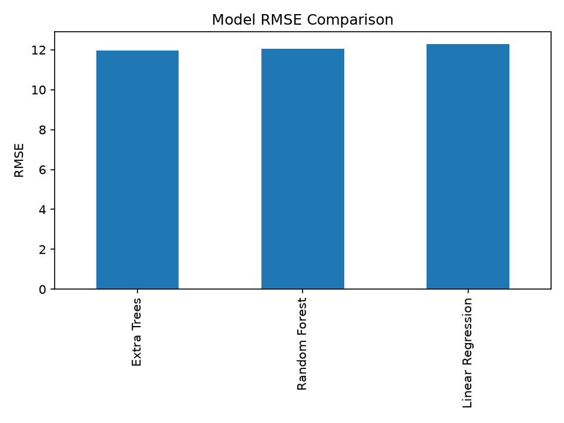
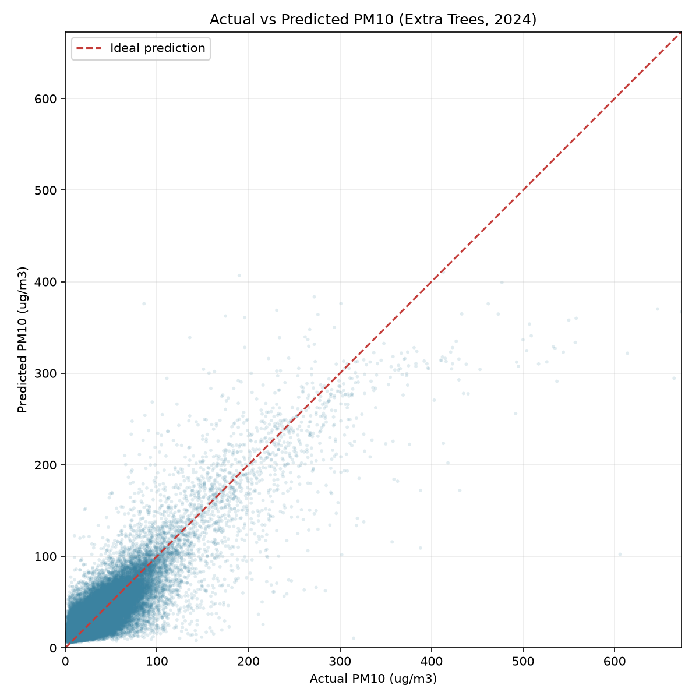

# 📊 기상·지역 요인을 고려한 국내 미세먼지 농도 분석과 예측

> 데이터분석 기말 프로젝트 · 인하공업전문대학 · 정한빛 (202244044)
>
> 한 줄 요약: 기상청 기상·PM10 자료를 관측소별 시각 기준으로 결합해 다음 시간 PM10을 예측했으며, Extra Trees 회귀가 가장 높은 성능을 기록했다.

<!--
✏️ 작성 가이드
- [대괄호] 부분과 ✏️ 주석을 지우고 내용을 채우세요.
- 표·그래프 자리는 실제 결과로 교체하세요. 그래프 이미지는 images/ 폴더에 저장 후 링크합니다.
- 필수 조건: 머신러닝 알고리즘 1개 이상 사용 (통계적 방법론만으로는 안 됨, 머신러닝 + 통계 방법은 가능)
-->

---

## 📑 목차

1. [서론](#1-서론-introduction)
2. [데이터 및 분석 방법](#2-데이터-및-분석-방법-data--methodology)
3. [분석 결과](#3-분석-결과)
4. [결론](#4-결론)
5. [참고문헌 및 데이터 출처](#5-참고문헌-및-데이터-출처)
6. [폴더 구성 및 실행 방법](#-폴더-구성-및-실행-방법)

---

## 1. 서론 (Introduction)

### 1.1 분석 배경 및 필요성

**🔎 문제 제기**

미세먼지(PM10) 농도는 관측소와 시간대에 따라 달라지며, 이전 농도와 바람·강수 같은 기상 조건도 다음 시간의 농도 변화와 관련될 수 있습니다. 과거 농도만으로는 기상 변화에 따른 단기 변동을 충분히 설명하기 어려워, 관측 자료를 시간과 관측소 기준으로 결합해 살펴볼 필요가 있습니다. 본 프로젝트에서는 기상청 부유분진 시간자료를 예측 대상(PM10)으로, ASOS 시간자료를 기상 입력 변수로 사용합니다. 두 자료를 관측소 코드와 관측 시각으로 결합하고, 2023년 자료로 학습한 모델을 2024년 자료로 평가해 다음 시간 PM10 농도를 예측합니다. 이를 통해 단기 농도 변화와 관련된 요인을 살펴보고 관측소별 대기질 대응에 참고할 정보를 마련하고자 합니다.

<!-- ✏️ 예: "온라인 쇼핑몰의 고객 이탈률이 증가하고 있으나, 어떤 고객이 이탈할지 사전에 파악하기 어렵다." -->

**📚 분석 활용 자료**

| 구분 | 연구/자료 | 사용 데이터 · 방법 | 주요 결과 | 본 프로젝트와의 차이 |
|---|---|---|---|---|
| 1 | 한국환경공단 「에어코리아 최종확정 측정자료(2023년)」, 공공데이터포털, 2024 | 2023년 전국 측정소의 시간별 대기오염 자료 (약 566만 행) | PM10·PM2.5 등 주요 대기오염물질의 연간 관측값 제공 | 참고 자료로 확인했으며 이번 모델에는 직접 사용하지 않음 |
| 2 | 한국환경공단 「에어코리아 최종확정 측정자료(2024년)」, 공공데이터포털, 2025 | 2024년 전국 측정소의 시간별 대기오염 자료 (약 581만 행) | PM10·PM2.5 등 주요 대기오염물질의 연간 관측값 제공 | 참고 자료로 확인했으며 이번 모델에는 직접 사용하지 않음 |
| 3 | 기상청 「종관기상관측(ASOS) 시간자료(2023년)」, 기상자료개방포털 | 2023년 전국 97개 관측소 시간자료 (약 84만 행) | 강수량·풍속·풍향 관측값 제공 | PM10 자료와 관측소·시각 기준으로 결합해 입력 변수로 사용 |
| 4 | 기상청 「종관기상관측(ASOS) 시간자료(2024년)」, 기상자료개방포털 | 2024년 전국 97개 관측소 시간자료 (약 85만 행) | 강수량·풍속·풍향 관측값 제공 | PM10 자료와 관측소·시각 기준으로 결합해 입력 변수로 사용 |
| 5 | 기상청 「부유분진 시간자료(2023년)」, 기상자료개방포털 | 전국 29개 관측소의 시간별 농도 (약 22.7만 행) | 1시간 평균 미세먼지 농도(㎍/㎥) 제공 | PM10 예측 대상이며 2023년 학습 자료로 사용 |
| 6 | 기상청 「부유분진 시간자료(2024년)」, 기상자료개방포털 | 전국 29개 관측소의 시간별 농도 (약 22.3만 행) | 1시간 평균 미세먼지 농도(㎍/㎥) 제공 | PM10 예측 대상이며 2024년 평가 자료로 사용 |
| 7 | 기후에너지환경부 국가미세먼지정보센터 「국가 대기오염물질 배출량 통계(2023년)」, 공공데이터포털 | 2023년 전국 시군구·배출원·연료별 배출량 (약 4.7만 행, 단위: kg) | PM10·PM2.5·NOx 등 대기오염물질 배출량 제공 | 향후 확장 후보 자료로 확인했으며 이번 모델에는 포함하지 않음 |

**🎯 분석의 필요성**

- 분석 목표: 기상·지역 요인과 과거 농도를 활용해 다음 시간의 미세먼지(PM10) 농도를 회귀 예측한다.
- 기대 효과: 고농도 시간대와 지역을 사전에 파악해 대기질 관리와 대응 계획에 참고한다.

---

## 2. 데이터 및 분석 방법 (Data & Methodology)

### 2.1 데이터 개요 및 전처리

**📂 데이터 출처**

| 항목 | 내용 |
|---|---|
| 데이터셋 | 기상청 ASOS 기상자료 + 부유분진 PM10 자료 |
| 출처 | 기상자료개방포털 |
| 규모 | 결합 후 2023년 182,697행, 2024년 179,849행 |
| 타깃 변수 | `target_next_pm10` (다음 시간 PM10 농도, μg/m³) |
| 기간 | 2023년 및 2024년 |

**주요 변수 설명**

| 변수명 | 설명 | 타입 |
|---|---|---|
| `lag1_pm10` | 직전 1시간 PM10 농도 | 수치형 |
| `lag24_pm10` | 직전 24시간 PM10 농도 | 수치형 |
| `rolling24_pm10` | 직전 24시간 이동평균 PM10 | 수치형 |
| `precipitation` | 강수량(mm) | 수치형 |
| `wind_speed` | 풍속(m/s) | 수치형 |
| `wind_direction` | 풍향(16방위) | 수치형 |
| `target_next_pm10` | 다음 시간 PM10 농도 | 타깃 |

**🧹 데이터 전처리**

1. 결측치 처리: 타깃 결측 행 제거, 강수는 0으로 대체, 풍속·풍향은 관측소별 중앙값으로 대체
2. 이상치 처리: 극단값을 사전에 제거하지 않고 원자료 분포를 유지
3. 중복 제거: 관측소 코드와 시각 기준으로 결합
4. 범주형 인코딩: 관측소 코드는 수치형 식별자로 사용
5. 스케일링: 트리 계열 모델과 선형 회귀를 비교하기 위해 별도 스케일링은 적용하지 않음
6. 학습/테스트 분할: 2023년으로 학습하고 2024년으로 평가하는 연도 간 분할

### 2.2 탐색적 데이터 분석 (EDA)

**주요 변수 기술통계량**

아래 통계량은 학습 자료인 2023년 182,697개 행을 기준으로 계산했습니다. 농도 단위는 μg/m³이며 강수량은 mm, 풍속은 m/s입니다.

| 변수 | 평균 | 표준편차 | 최솟값 | 중앙값 | 최댓값 |
|---|---:|---:|---:|---:|---:|
| 다음 시간 PM10 (`target_next_pm10`) | 31.704 | 30.319 | 0 | 24 | 713 |
| 직전 1시간 PM10 (`lag1_pm10`) | 31.702 | 30.319 | 0 | 24 | 713 |
| 직전 24시간 PM10 (`lag24_pm10`) | 31.733 | 30.333 | 0 | 24 | 713 |
| 직전 24시간 평균 (`rolling24_pm10`) | 31.717 | 25.370 | 4.667 | 25.042 | 338.750 |
| 강수량 (`precipitation`) | 0.138 | 1.118 | 0 | 0 | 66.7 |
| 풍속 (`wind_speed`) | 2.328 | 2.241 | 0 | 1.8 | 27.9 |

**상관계수 분석**


다음 시간 PM10은 직전 1시간 농도와 가장 높은 양의 상관(r=0.895)을 보였고, 24시간 이동평균과도 양의 상관(r=0.707)을 보였습니다. 직전 24시간 농도와의 상관은 r=0.455였습니다. 강수량은 약한 음의 상관(r=-0.074), 풍속은 매우 약한 양의 상관(r=0.036)을 보여 단순 선형 상관만으로 영향력을 단정하기 어렵습니다.

직전 1시간 농도와 24시간 이동평균(r=0.758), 직전 24시간 농도와 24시간 이동평균(r=0.758)은 서로 상관이 높습니다. 상관은 인과관계를 의미하지 않으며, 풍향은 각도형 데이터이므로 일반 Pearson 상관계수 계산에서 제외했습니다. 관측소 코드와 시간 변수도 식별자·주기형 값이어서 히트맵에 포함하지 않았습니다.

**분포 및 관계 시각화**


PM10 농도 분포는 오른쪽 꼬리가 길고, 최댓값 713 μg/m³의 고농도 관측치가 포함되어 있습니다. 강수량은 중앙값이 0 mm이며 일부 강한 강수 관측이 있어 분포 그래프에서는 `log(1+x)`로 변환해 표시했습니다. 원자료의 극단값은 제거하지 않았습니다.

### 2.3 분석 기법 및 모델링

**⚙️ 적용 기법 / 알고리즘**

| 모델 | 선택 이유 | 주요 하이퍼파라미터 |
|---|---|---|
| [예: Logistic Regression] | [베이스라인 모델] | [C, max_iter] |
| [예: Random Forest] | [비선형 관계, 특성 중요도 확인] | [n_estimators, max_depth] |
| [예: XGBoost / LightGBM] | [부스팅 계열 성능 비교] | [learning_rate, n_estimators] |

<!-- ✏️ 선택 가능: Decision Tree / Random Forest / SVM / Logistic Regression / AdaBoost / XGBoost / LGBM 등.
     강의 외 머신러닝 알고리즘도 가능. 통계적 방법(회귀분석, 가설검정 등)을 함께 써도 됩니다. -->

- 하이퍼파라미터 탐색: [GridSearchCV / RandomizedSearchCV, 탐색 범위]
- 검증 방법: [K-Fold 교차 검증 (k=5) 등]

**📏 평가 지표**

- 분류: Accuracy, Precision, Recall, F1-score
- 회귀: RMSE, MAE, R²

<!-- ✏️ 문제 유형에 맞는 지표만 남기세요. -->

---

## 3. 분석 결과

### 3.1 모델링 및 세부 분석 결과

**📊 모델 성능 비교**

| 모델 | RMSE | MAE | R² |
|---|---:|---:|---:|
| Linear Regression | 12.2768 | 7.5836 | 0.7501 |
| Random Forest | 12.0624 | 7.3287 | 0.7588 |
| **Extra Trees** | **11.9717** | **7.3122** | **0.7624** |

<!-- ✏️ 회귀 문제라면 열을 RMSE / MAE / R² 로 바꾸세요. 가장 좋은 성능은 **굵게** 표시합니다. -->

👉 최종 선택 모델: **Extra Trees**, 선택 이유: 세 모델 중 RMSE가 가장 낮고 R²가 가장 높음

**🔑 주요 영향 요인 (Feature Importance)**

| 순위 | 변수 | 영향력 크기 (중요도 또는 계수) |
|---|---|---|
| 1 | 과거 PM10 및 이동평균 변수 | lag1, lag24, 24시간 이동평균 |
| 2 | 기상 변수 | 풍속, 풍향, 강수량 |
| 3 | 시·계절·관측소 변수 | 시각, 월, 요일, 관측소 코드 |

**📈 시각화**






---

## 4. 결론

### 4.1 결과 해석 및 의미

- **전체 분석 요약 및 핵심 결론**: 2023년 관측소별 자료로 학습한 모델을 2024년 자료로 평가한 결과 Extra Trees가 R² 0.7624로 가장 높은 성능을 보였다.
- **결과의 원인 및 배경 해석**: 미세먼지는 시간적으로 연속성이 크기 때문에 직전 및 과거 PM10 값이 다음 시간 농도 예측에 중요한 근거가 된다.

### 4.2 실행 제언 (비즈니스 / 실무적 시사점)

분석 결과를 기반으로 한 구체적 액션 플랜이나 전략을 제안합니다.

1. PM10 급등 징후가 예상될 때 관측소별 선제 대응 기준을 운영
2. 강수·풍속·풍향을 실제 수집 시점과 결합해 단기 예보 시스템으로 확장
3. 지역 배출량 자료와 관측소 위치 정보를 추가해 지역별 예측으로 확장

### 4.3 연구의 한계점

- 데이터 수집 과정의 한계: 기상·PM10 자료에서 관측소 코드가 일치한 23개 관측소만 사용
- 외생 변수 통제 미흡: 교통량, 실시간 배출량, 국외 이동성 자료는 본 분석에 포함하지 않았음
- 차후 개선 사항: 2023년 배출량 자료의 지역 단위 연동, 시계열 교차검증, 하이퍼파라미터 탐색 필요

---

## 5. 참고문헌 및 데이터 출처

**📂 데이터 세트**

- 기상청, 「종관기상관측(ASOS) 시간자료」(2023–2024): [기상자료개방포털](https://data.kma.go.kr/data/grnd/selectAsosRltmList.do?pgmNo=36)
- 기상청, 「부유분진 시간자료」(2023–2024): [기상자료개방포털](https://data.kma.go.kr/)에서 데이터명으로 검색

**📚 참고 문헌 · 도서 · 보고서**

1. Breiman, L., “Random Forests,” *Machine Learning*, 45, 5–32, 2001. [https://doi.org/10.1023/A:1010933404324](https://doi.org/10.1023/A:1010933404324)
2. Geurts, P., Ernst, D., and Wehenkel, L., “Extremely randomized trees,” *Machine Learning*, 63, 3–42, 2006. [https://doi.org/10.1007/s10994-006-6226-1](https://doi.org/10.1007/s10994-006-6226-1)
3. scikit-learn developers, “ExtraTreesRegressor API Reference.” [https://scikit-learn.org/stable/modules/generated/sklearn.ensemble.ExtraTreesRegressor.html](https://scikit-learn.org/stable/modules/generated/sklearn.ensemble.ExtraTreesRegressor.html)

**🤖 사용한 생성형 AI**

| AI 이름 | 활용 내용 |
| Claude Code | 데이터 구조 검토, 전처리·모델링 코드 초안 및 분석 산출물 생성 |

<!-- ✏️ 실제로 사용한 AI와 범위를 구체적으로 적으세요. AI가 만든 코드는 직접 이해·검증한 뒤 사용했다는 점도 함께 밝히면 좋습니다. -->

---

## 🗂️ 폴더 구성 및 실행 방법

```
final_project/
├── data/
│   ├── kma_pm10_hourly_2023.csv
│   ├── kma_pm10_hourly_2024.csv
│   ├── kma_asos_hourly_2023.csv
│   └── kma_asos_hourly_2024.csv
├── images/
│   ├── correlation_heatmap.png
│   ├── eda_distribution.png
│   ├── model_comparison.png
│   ├── feature_importance.png
│   └── actual_vs_predicted.png
├── analysis.py                # 자료 결합 및 모델 실행 스크립트
├── final_project.ipynb        # 전체 분석 코드 (Colab)
├── model_results.csv
└── README.md
```

**실행 방법**

1. `final_project.ipynb`를 Google Colab에서 엽니다.
2. 프로젝트 전체를 Colab 환경에 업로드합니다.
3. 필요한 라이브러리를 설치합니다: `!pip install pandas scikit-learn matplotlib`
4. 노트북 또는 `python analysis.py`를 실행합니다.

전처리 데이터와 전체 예측 결과 파일은 실행 시 생성되며 저장소에는 포함하지 않습니다.

**사용 라이브러리**


