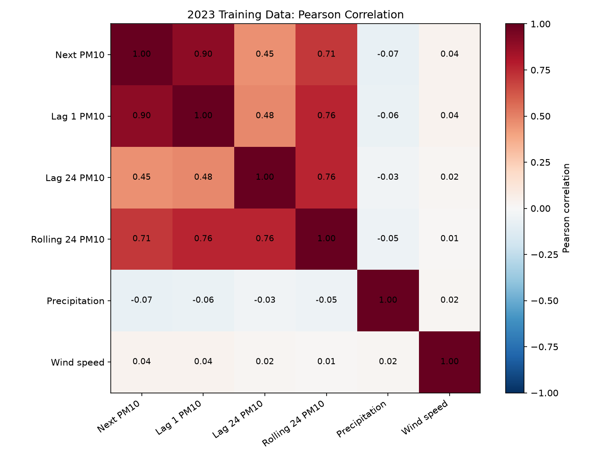
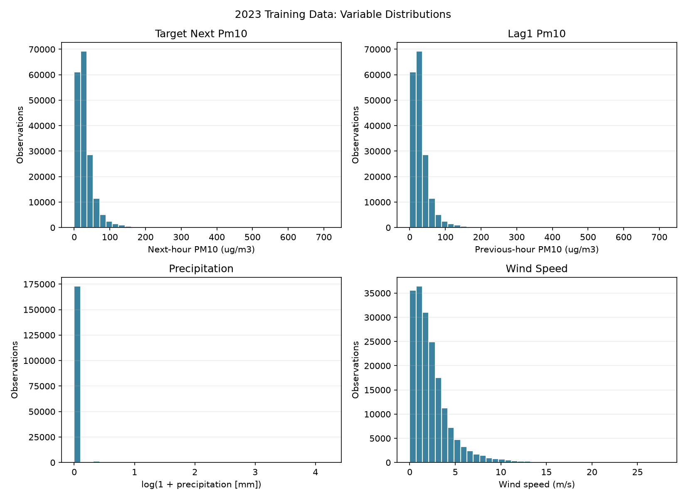
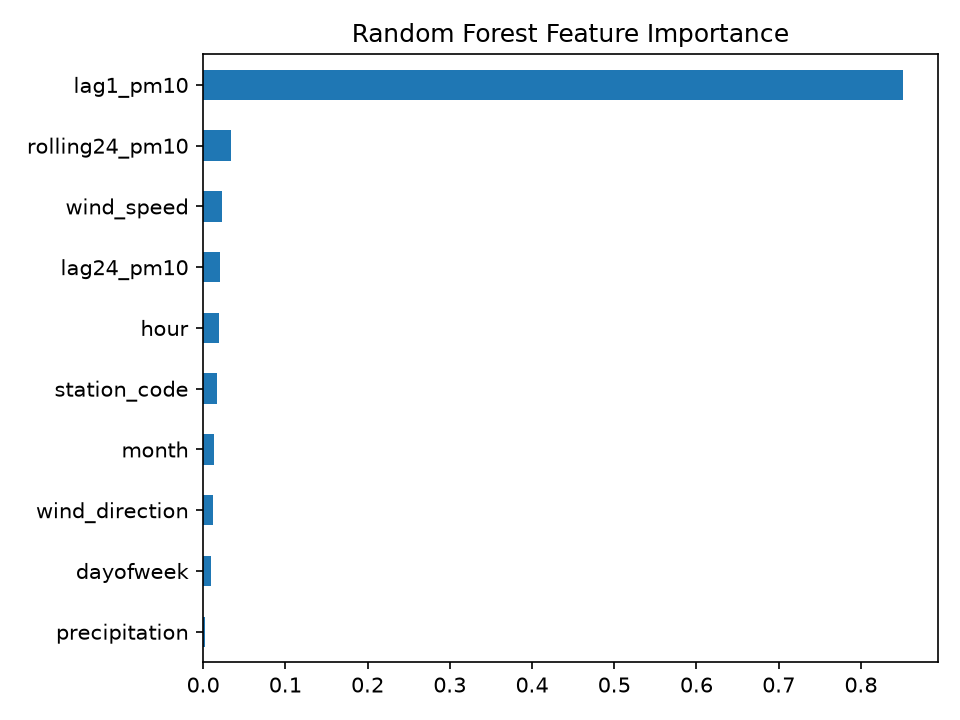

# 📊 기상·지역 요인을 고려한 국내 미세먼지 농도 분석과 예측

> 데이터분석 기말 프로젝트 · 인하공업전문대학 · 정한빛 (202244044)
>
> 한 줄 요약: `[어떤 데이터로 무엇을 예측/분류했고, 어떤 결론을 얻었는지 한 문장으로]`

<!--
✏️ 작성 가이드
- [대괄호] 부분과 ✏️ 주석을 지우고 내용을 채우세요.
- 표·그래프 자리는 실제 결과로 교체하세요. 그래프 이미지는 images/ 폴더에 저장 후 링크합니다.
- 필수 조건: 머신러닝 알고리즘 1개 이상 사용 (통계적 방법론만으로는 안 됨, 머신러닝 + 통계 방법은 가능)
-->

---

## 📑 목차

1. [서론](#1-서론-introduction)
2. [데이터 및 분석 방법](#2-데이터-및-분석-방법-data--methodology)
3. [분석 결과](#3-분석-결과)
4. [결론](#4-결론)
5. [참고문헌 및 데이터 출처](#5-참고문헌-및-데이터-출처)
6. [폴더 구성 및 실행 방법](#-폴더-구성-및-실행-방법)

---

## 1. 서론 (Introduction)

### 1.1 분석 배경 및 필요성

**🔎 문제 제기**

미세먼지 농도는 지역 내 교통·산업 활동에서 나오는 배출뿐 아니라 바람과 강수 같은 기상 조건, 먼 지역에서 이동해 오는 황사와 오염물질의 영향도 받습니다. 여러 요인이 함께 작용하기 때문에 특정 지역의 농도가 높아지는 이유와 앞으로의 변화를 파악하기 어렵습니다. 본 프로젝트에서는 에어코리아 측정자료를 기상·황사 관측자료 및 지역별 배출 특성 자료와 함께 분석하고, 과거 농도와 관련 요인을 바탕으로 향후 미세먼지 농도를 예측하고자 합니다. 이를 통해 고농도와 관련된 요인을 살펴보고 지역별 대비에 참고할 정보를 마련합니다.

<!-- ✏️ 예: "온라인 쇼핑몰의 고객 이탈률이 증가하고 있으나, 어떤 고객이 이탈할지 사전에 파악하기 어렵다." -->

**📚 분석 활용 자료**

| 구분 | 연구/자료 | 사용 데이터 · 방법 | 주요 결과 | 본 프로젝트와의 차이 |
|---|---|---|---|---|
| 1 | 한국환경공단 「에어코리아 최종확정 측정자료(2023년)」, 공공데이터포털, 2024 | 2023년 전국 측정소의 시간별 대기오염 자료 (약 566만 행) | PM10·PM2.5 등 주요 대기오염물질의 연간 관측값 제공 | 2024년 자료와 함께 학습·연도별 비교에 활용 |
| 2 | 한국환경공단 「에어코리아 최종확정 측정자료(2024년)」, 공공데이터포털, 2025 | 2024년 전국 측정소의 시간별 대기오염 자료 (약 581만 행) | PM10·PM2.5 등 주요 대기오염물질의 연간 관측값 제공 | 기상·황사·지역 요인과 결합해 미세먼지 예측 |
| 3 | 기상청 「종관기상관측(ASOS) 시간자료(2023년)」, 기상자료개방포털 | 2023년 전국 97개 관측소 시간자료 (약 84만 행) | 강수량·풍속·풍향 관측값 제공 | 2023년 미세먼지 자료에 기상 요인 추가 |
| 4 | 기상청 「종관기상관측(ASOS) 시간자료(2024년)」, 기상자료개방포털 | 2024년 전국 97개 관측소 시간자료 (약 85만 행) | 강수량·풍속·풍향 관측값 제공 | 2024년 미세먼지 자료에 기상 요인 추가 |
| 5 | 기상청 「부유분진 시간자료(2023년)」, 기상자료개방포털 | 전국 29개 관측소의 시간별 농도 (약 22.7만 행) | 1시간 평균 미세먼지 농도(㎍/㎥) 제공 | 에어코리아 PM10 자료와 비교·보완 |
| 6 | 기상청 「부유분진 시간자료(2024년)」, 기상자료개방포털 | 전국 29개 관측소의 시간별 농도 (약 22.3만 행) | 1시간 평균 미세먼지 농도(㎍/㎥) 제공 | 에어코리아 PM10 자료와 비교·보완 |
| 7 | 기후에너지환경부 국가미세먼지정보센터 「국가 대기오염물질 배출량 통계(2023년)」, 공공데이터포털 | 2023년 전국 시군구·배출원·연료별 배출량 (약 4.7만 행, 단위: kg) | PM10·PM2.5·NOx 등 대기오염물질 배출량 제공 | 연간 지역 배출 특성을 입력 변수로 결합 |

**🎯 분석의 필요성**

[데이터 분석을 통해 얻고자 하는 가치나 목적을 명시하세요.]

- 분석 목표: 기상·지역 요인과 과거 농도를 활용해 다음 시간의 미세먼지(PM10) 농도를 회귀 예측한다.
- 기대 효과: 고농도 시간대와 지역을 사전에 파악해 대기질 관리와 대응 계획에 참고한다.

---

## 2. 데이터 및 분석 방법 (Data & Methodology)

### 2.1 데이터 개요 및 전처리

**📂 데이터 출처**

| 항목 | 내용 |
|---|---|
| 데이터셋 | [데이터셋 이름] |
| 출처 | [Kaggle / 공공데이터포털 / AI Hub 등 + URL] |
| 규모 | [행 수] rows × [열 수] columns |
| 타깃 변수 | `[컬럼명]` ([분류: 클래스 설명 / 회귀: 단위]) |
| 기간 | [데이터 수집 기간, 해당 시] |

**주요 변수 설명**

| 변수명 | 설명 | 타입 |
|---|---|---|
| `[col1]` | [설명] | 수치형 / 범주형 |
| `[col2]` | [설명] | 수치형 / 범주형 |
| `[target]` | [설명] | 타깃 |

**🧹 데이터 전처리**

1. 결측치 처리: [제거 / 평균·중앙값 대체 등, 처리한 행·열 수]
2. 이상치 처리: [IQR, 박스플롯 기준 등]
3. 중복 제거: [`drop_duplicates()` 결과]
4. 범주형 인코딩: [LabelEncoder / One-Hot Encoding]
5. 스케일링: [StandardScaler / MinMaxScaler]
6. 학습/테스트 분할: [예: 8:2, `random_state=42`, 분류 시 `stratify` 사용 여부]

### 2.2 탐색적 데이터 분석 (EDA)

**주요 변수 기술통계량**

| 변수 | 평균 | 표준편차 | 최솟값 | 중앙값 | 최댓값 |
|---|---|---|---|---|---|
| `[col1]` | | | | | |
| `[col2]` | | | | | |

<!-- ✏️ df.describe() 결과를 정리해서 넣으세요. -->

**상관계수 분석**



- [타깃과 상관이 높은 변수와 그 값]
- [변수 간 다중공선성이 의심되는 조합]

**분포 및 관계 시각화**



- [그래프에서 발견한 특징 1]
- [그래프에서 발견한 특징 2]

### 2.3 분석 기법 및 모델링

**⚙️ 적용 기법 / 알고리즘**

| 모델 | 선택 이유 | 주요 하이퍼파라미터 |
|---|---|---|
| [예: Logistic Regression] | [베이스라인 모델] | [C, max_iter] |
| [예: Random Forest] | [비선형 관계, 특성 중요도 확인] | [n_estimators, max_depth] |
| [예: XGBoost / LightGBM] | [부스팅 계열 성능 비교] | [learning_rate, n_estimators] |

<!-- ✏️ 선택 가능: Decision Tree / Random Forest / SVM / Logistic Regression / AdaBoost / XGBoost / LGBM 등.
     강의 외 머신러닝 알고리즘도 가능. 통계적 방법(회귀분석, 가설검정 등)을 함께 써도 됩니다. -->

- 하이퍼파라미터 탐색: [GridSearchCV / RandomizedSearchCV, 탐색 범위]
- 검증 방법: [K-Fold 교차 검증 (k=5) 등]

**📏 평가 지표**

- 분류: Accuracy, Precision, Recall, F1-score
- 회귀: RMSE, MAE, R²

<!-- ✏️ 문제 유형에 맞는 지표만 남기세요. -->

---

## 3. 분석 결과

### 3.1 모델링 및 세부 분석 결과

**📊 모델 성능 비교**

| 모델 | Accuracy | Precision | Recall | F1-score |
|---|---|---|---|---|
| [모델 1] | | | | |
| [모델 2] | | | | |
| [모델 3] | | | | |

<!-- ✏️ 회귀 문제라면 열을 RMSE / MAE / R² 로 바꾸세요. 가장 좋은 성능은 **굵게** 표시합니다. -->

👉 최종 선택 모델: **[모델명]**, 선택 이유: [성능, 해석 가능성 등]

**🔑 주요 영향 요인 (Feature Importance)**

| 순위 | 변수 | 영향력 크기 (중요도 또는 계수) |
|---|---|---|
| 1 | `[1순위 중요 변수]` | [값] |
| 2 | `[2순위 중요 변수]` | [값] |
| 3 | `[3순위 중요 변수]` | [값] |

**📈 시각화**





<!-- ✏️ 회귀라면 혼동 행렬 대신 '실제값 vs 예측값' 산점도를 넣으세요. -->

---

## 4. 결론

### 4.1 결과 해석 및 의미

- **전체 분석 요약 및 핵심 결론**: [한두 문장으로]
- **결과의 원인 및 배경 해석**: [왜 이 변수가 중요하게 나왔는지, 도메인 관점에서 설명]

### 4.2 실행 제언 (비즈니스 / 실무적 시사점)

분석 결과를 기반으로 한 구체적 액션 플랜이나 전략을 제안합니다.

1. [제언 1: 예) 1순위 변수 기준으로 고위험군을 선별해 맞춤 관리]
2. [제언 2]
3. [제언 3]

### 4.3 연구의 한계점

- 데이터 수집 과정의 한계: [표본 크기, 기간, 편향 등]
- 외생 변수 통제 미흡: [데이터에 없는 영향 요인]
- 차후 개선 사항: [추가 데이터, 다른 모델, 하이퍼파라미터 확장 등]

---

## 5. 참고문헌 및 데이터 출처

**📂 데이터 세트**

- [데이터셋 이름]: [URL]

**📚 참고 문헌 · 도서 · 보고서**

1. [저자, 「제목」, 학술지/출판사, 연도]
2. [저자, 「제목」, 학술지/출판사, 연도]
3. [기관, 「보고서명」, 연도, URL]

**🤖 사용한 생성형 AI**

| AI 이름 | 활용 내용 |
|---|---|
| [예: ChatGPT] | [예: 보고서 문장 다듬기, 기존 연구 조사 방향 잡기] |
| [예: Claude Code] | [예: 전처리·시각화 코드 초안 작성 및 오류 디버깅] |

<!-- ✏️ 실제로 사용한 AI와 범위를 구체적으로 적으세요. AI가 만든 코드는 직접 이해·검증한 뒤 사용했다는 점도 함께 밝히면 좋습니다. -->

---

## 🗂️ 폴더 구성 및 실행 방법

```
final_project/
├── data/
│   └── [dataset].csv          # 원본 데이터
├── images/                    # README에 쓰인 그래프
├── final_project.ipynb        # 전체 분석 코드 (Colab)
└── README.md
```

**실행 방법**

1. `final_project.ipynb`를 Google Colab에서 엽니다.
2. `data/[dataset].csv`를 Colab에 업로드합니다.
3. 필요한 라이브러리를 설치합니다: `!pip install [xgboost lightgbm 등]`
4. 위에서부터 순서대로 셀을 실행합니다.

**사용 라이브러리**


